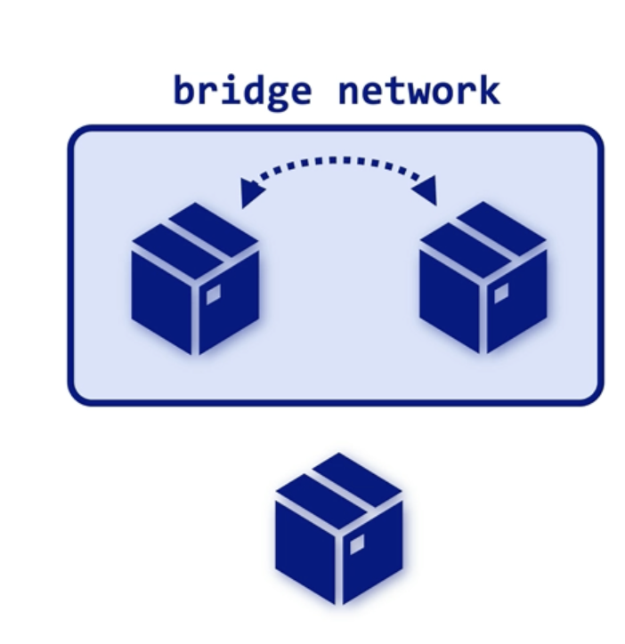
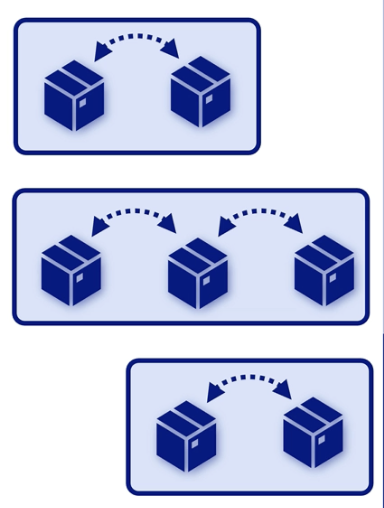

# Networking in Docker

Docker networks allow containers to communicate securely and efficiently by simulating a traditional network.

- this seamless interaction makes containers incredibly scalable and powerful.

> Note: Communication between containers
> - In Docker, each service must be run within an isolated container, but an application may have multiple services.
> - Example:
>   - 1 container for MySQL/MariaDB service
>   - 1 container for phpMyAdmin(management software for MySQL/MariaDB)
>   - 1 container for Wordpress
> - Create a network for communication between containers

## Default networks in Docker

- Docker comes with predefined networks.
    - bridge
        - enables communication between standalone containers
        - but keeps them isolated from the external world
            - from external world not able to connect to containers in bridge network, but from within the network able to connect to the external world

        
        - How it works?
            - docker establishes a private subnet for containers
                - typically within the IP range 172.17.0.0/16
            - containers must be executed on the same host
            -default network => if no network assigned at launch, containers will be connected to bridge netwrok by default
        
        > Note: Publishing ports using -p is separate from networking. This can still be used to publish container ports for external access.


    - host
        - containers network is directly integrated to the host => there is no network isolation!
            - containers are accessible via the IP address of the host.
            - ports that the container open are directly accessible on the host system.
            - can only have a single host network per host.
        
        > Note:
        > - publishing ports with -p no longer work.
        > - `host` type only supported on Linux hosts as on Windows and MacOS Docker runs in a virtual machine.

    - none
        - networking capabilities of the container are disabled
            - can't access container from the external world
            - can't access internet from the container
            - port mappings are not applicable either
        - not network interface is created except the loopback interface(localhost)
        - cannot create this network type manually
        - ```
        docker run --network none
        ```

- Each network has a unique name and unique id

- Inspect via:
```docker
docker network ls
```

- Inspect a network via:
```docker
docker network inspect [network-name/id]
```

> Note:
> - Show IP addresses: `ip addr show`
> - This command displays the host's network interfaces and their IPv4/IPv6 addresses, including Docker bridge interfaces.
> - If `ip` is not installed on Linux, install it with:
>   - Debian/Ubuntu: `sudo apt install iproute2`
>   - RHEL/Fedora/CentOS: `sudo dnf install iproute`
> - macOS does not use `ip`; use `ifconfig` or `networksetup -getinfo Wi-Fi` instead.


## Custom bridge networks

- can create our own custom bridge network
    - allows to create containers that can only communicate with each other
- Why?
    - isolates specific groups of containers from others in the system
    - reduces attack surface leading to more secure deployment
    

- How?
```docker
docker network create [network-name]

docker container run --network [network-name]
```

- To delete network:
```docker
docker network rm [network-name]
```

- Delete all unused network:
```docker
docker network prune
```

> Note:
> - Containers can be part of multiple networks.

- Connect container to an existing network:
```docker
docker network connect [network-name/id] [container-name/id]

- Disonnect container from a network:
```docker
docker network disconnect [network-name/id] [container-name/id]
```

## Working with hostnames

- In default bridge network, containers can only access each other through IP addresses.
- In custom bridge network:
    - containers can access each other through IP addresses.
    - In addition, custom network enables DNS resolution of container names to their respective IP addresses.
        - containers can communicate by names.