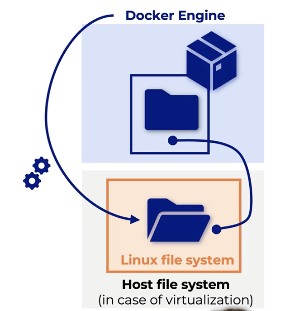

# Volumes in Docker

Volume is a mechanism to map container data to a directory(hidden) on the host



- Volume can linked to multiple containers
- volumes are directly managed by docker engine and are thus efficient

> Note: Never access volumes directly!
> 
> - Should only be accessed via ``` docker volume```

## How to create and manage volumes?

```docker
docker volume create volume-name

```

- Show all volumes
```docker
docker volume ls
```

- show additional volume information
```docker
docker volume inspect volume-name
```

- delete a volume
```docker
docker volume rm volume-name
```

- auto delete unused volumes
```docker
docker volume prune
```

> Note: It is impossible to rename a volume.
> - will need to create a new volume and copy files to it if needed.
> - this is because several containers could be using a volume and renaming volume would create ambiguity for containers using it.

## Attach volumes to containers

- Similar to bind mounts, use --mount to connect to volumes
```docker
--mount type=volume,source=[volume-name],destination=[container-path]
```
Example:
```docker
docker run -it -p 8088:80 --mount=volume,source=nginx-vol,destination=/user/share/nginx/html nginx
```
> Note: If a volume does not exist at the time of mount, it will be created automatically.

- Alternatively we can use -v instead
```docker
-v [volume-name]:[directory in container]
```

> Note:
> - This is very similar to creating a bind mount.
> - The difference is that directory/bind mount would have started with "/" instead of volume name.

> Note: Bind mount vs volume mount
> - A bind mount connects a container to a specific file or directory on the host.
> - A volume mount uses storage managed by Docker instead of a host path.
> - Use a bind mount when you need direct access to host files; use a volume when Docker should manage the persistent data.
> - Example: 
>   - Store a database's files in a Docker volume so the database container can be removed or recreated without losing its data. A replacement container can attach to the same volume and continue using the existing database.
>   - A bind mount would also work, but it would require choosing and managing a specific host directory. This makes the setup less portable and can cause permission or path differences on another machine.

## Automatically created volumes

- Some containers automatically create volumes for us
    - this allows data to be stored outside of the container and allows an easy update.

- Example:
    - MariaDB container:
    ```docker
    docker run -it -e MARIADB_ROOT_PASSWORD=password123 mariadb
    ```
    - -e sets the environment variable.
    - Check the volume information:
    ```docker
    docker container inspect [container-id] -f "{{.Mounts}}"
    ```
    - Better to name the volume:
    ```docker
    docker run -it -v maria-vol:/var/lib/mysql -e MARIADB_ROOT_PASSWORD=password123 mariadb
    ```

## Configure volumes in dockerfile

- can enforce that a directory will be placed in a volume through dockerfile
```docker
VOLUME [folder]
```
- useful if we manage data ourselves in our applications
- once set, VOLUME directive cannot be undone.

